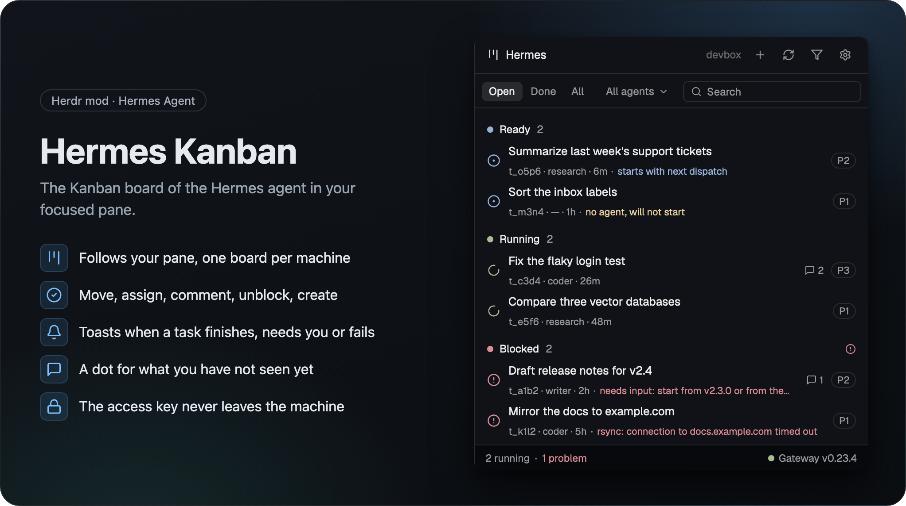
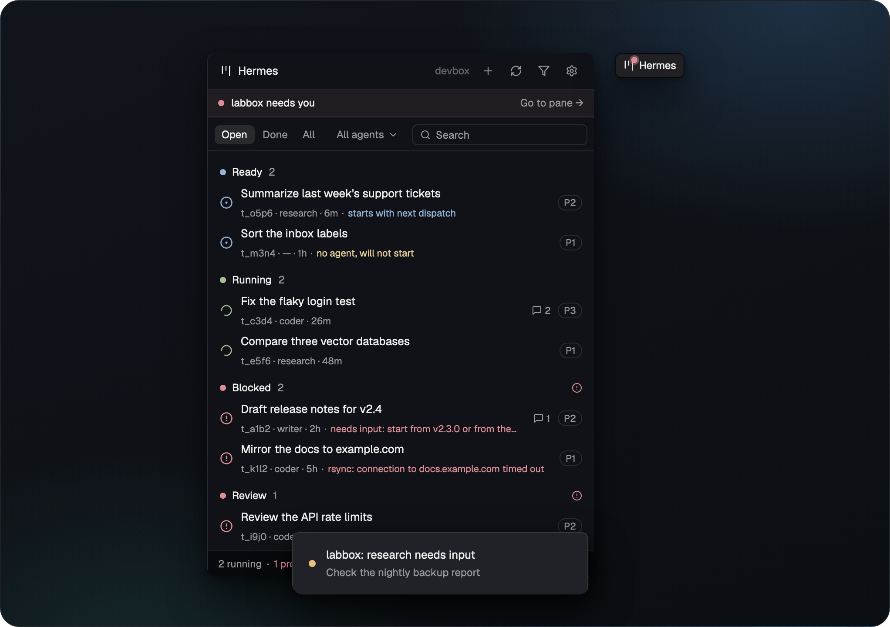
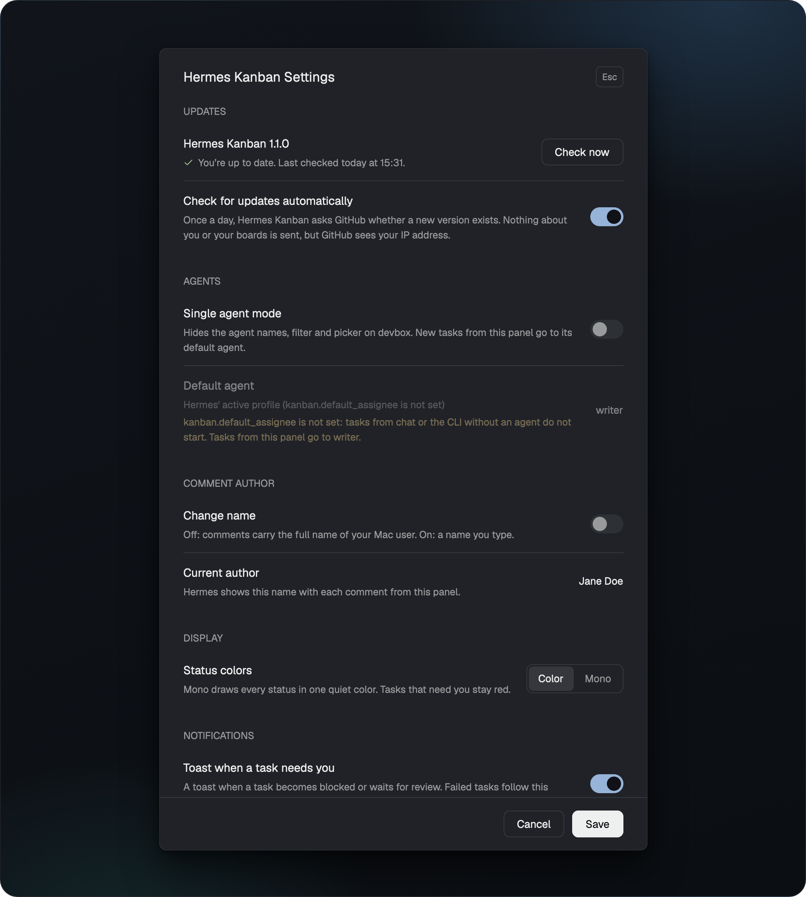

# Hermes Kanban



**See and steer the Kanban board of your Hermes agents, right inside the [Herdr app](https://herdr.dev).**

Click into any pane on a machine that runs Hermes, and the panel shows that Hermes' tasks. Move them, comment, unblock or create new ones without leaving Herdr. When a task needs you, fails or finishes, Herdr tells you, even while the panel is closed.

To start, install the mod (see below), focus a pane on your Hermes machine and click `Hermes` in the tab bar.

<br>

<p align="center"><a href="https://www.buymeacoffee.com/michaelmayer"></a></p>

<br>

## Install

In Herdr, ask your agent:

```text
Read ~/.config/herdr-app/AGENTS.md, then add this mod: https://github.com/Srv-02/herdr-hermeskanban/tree/main
```

Then focus a pane on a machine that runs Hermes and click `Hermes` in the tab bar.

You need:

- Herdr on macOS.
- Hermes Agent 0.23.4 or newer, on a Linux machine that Herdr reaches as one of its machines.
- `curl` 7.55 or newer on that Linux machine.

The [guide](docs/GUIDE.md#requirements) lists every detail.

- **Updating:** the gear in the panel turns gold when a new version is out. Ask your agent to update the mod, the same way you installed it. See [Updates](docs/GUIDE.md#updates).
- **Install by hand or remove the mod:** see [Manual install](docs/GUIDE.md#manual-install) and [Removing](docs/GUIDE.md#removing).

## Features

### Board

- The panel always shows the Hermes of the machine you are on. Any pane there works, a plain shell too.
- Tasks are grouped as in Hermes: Triage, Todo, Scheduled, Ready, Running, Blocked, Review, Done.
- You can also group them by agent, or not at all.
- The newest tasks come first. One click on the sort toggle shows the oldest first.
- Each row tells you what is going on, for example why a task is blocked.
- Filter by open or done tasks, by agent, by priority, or search by text.
- The bar at the bottom shows how many tasks run and whether Hermes is up.

More in the guide: [The board](docs/GUIDE.md#the-board).


### Task overlay

- Click a task to open it in a large window.
- You see its description, its history and its comments.
- A blocked task shows why it is blocked, in a red box.
- Write a comment, or comment and unblock the task in one step.
- Assign an agent, change the priority or move the task. You only see the moves that Hermes allows.
- Archive a task. A second click confirms it. The mod never deletes a task.
- The `+` button in the header creates a new task.

More in the guide: [Task overlay](docs/GUIDE.md#task-overlay).


### Notifications

- A toast tells you when a task needs you, fails or finishes.
- Click the toast to jump to that machine. You land in the pane you used there last.
- The `Hermes` button in the tab bar carries a dot for news you have not seen yet.
- A red dot means something needs you. A green dot means a task is done.
- Opening the panel for that Hermes clears its dot.
- You can also get sounds and a dot on the Dock icon. Each has its own switch.

**What a click on the `Hermes` button does:**

- On a pane of a machine that runs Hermes, it opens or closes the panel.
- On any other pane, the button is grey. Its tooltip says `No Hermes on this machine`. Panes on your Mac count as such.
- If the panel is open there, a click still closes it.
- When another Hermes has a dot, the tooltip says `Go to labbox`, for example. One click jumps to that machine and opens the panel there. A red dot comes before a green one. This works from any pane.
- Inside the panel, a red strip `labbox needs you` with `Go to pane →` does the same.

More in the guide: [Notifications](docs/GUIDE.md#notifications).



### Set up access

- Some Hermes setups ask people to sign in. The panel then needs a key of its own.
- Click **Set up access**. The panel shows every step first and runs them only after you confirm.
- The Hermes gateway restarts only when you click **Restart gateway**.
- The key stays on the Hermes machine. It never reaches your Mac.
- **Remove access** in the settings undoes everything, step by step.
- Without sign-in, there is nothing to set up.

More in the guide: [Set up access](docs/GUIDE.md#set-up-access) and [Remove access](docs/GUIDE.md#remove-access).

### Settings

- The gear in the panel header opens the settings.
- Choose status colors, toasts, sounds, the Dock dot and how often the panel checks for news.
- Single agent mode hides agent names for a Hermes with only one agent.
- Once a day the panel checks GitHub for a new version. You can switch that off.

More in the guide: [Settings](docs/GUIDE.md#settings) and [Single agent mode](docs/GUIDE.md#single-agent-mode).



### And

- Each Hermes keeps its own board. Tasks of two machines never mix.
- On a machine without Hermes, the panel says `No Hermes on this machine`. It never shows an old board.
- Clicking into the panel, for example into the search, keeps the board.
- A machine counts only while it has an open space in Herdr.
- Text from Hermes shows as plain text. Links open only when you click them.
- If a new Hermes version changes its board, the panel says so instead of showing wrong data.
- You can bind keys to the panel's commands. See [Keys](docs/GUIDE.md#keys).

## Documentation

- **[Guide](docs/GUIDE.md):** every feature, setting and key in detail.
- **[What it runs and touches](docs/GUIDE.md#what-it-runs-and-touches):** every command on the Hermes machine and every file on your Mac.
- **[RECIPE.md](RECIPE.md):** the mod as a brief to build it from scratch.
- **[Development](docs/GUIDE.md#development):** tests and lint.

## Credits

- The panel, its tab bar button, the settings and the tooling follow [GitHub Checker](https://github.com/Srv-02/herdr-ghchecker) (MIT).
- The segmented control and the empty states come from [herdr-github](https://github.com/alarboulletmarin/herdr-github) by alarboulletmarin (MIT), the tab bar button from [herdr-issues](https://github.com/jankeesvw/herdr-issues) by Jankees van Woezik (MIT), both through GitHub Checker.
- Icons from [Lucide](https://lucide.dev) (ISC).

Details in [THIRD_PARTY_NOTICES.md](THIRD_PARTY_NOTICES.md). Hermes Kanban is not affiliated with Nous Research.

## License

MIT, see [LICENSE](LICENSE). Third party parts keep their own licenses.
