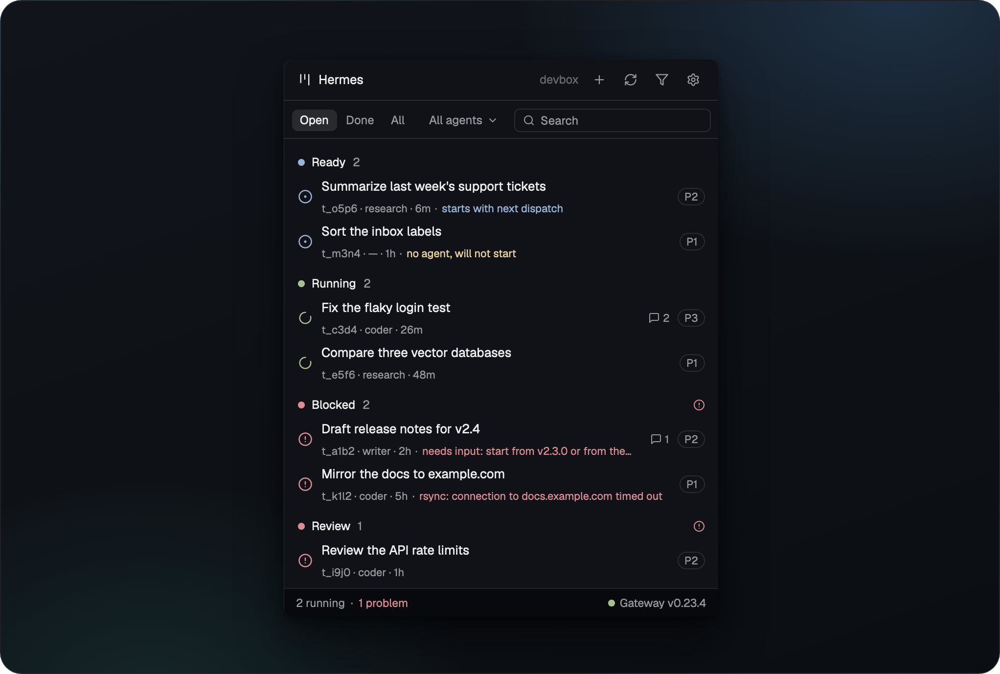
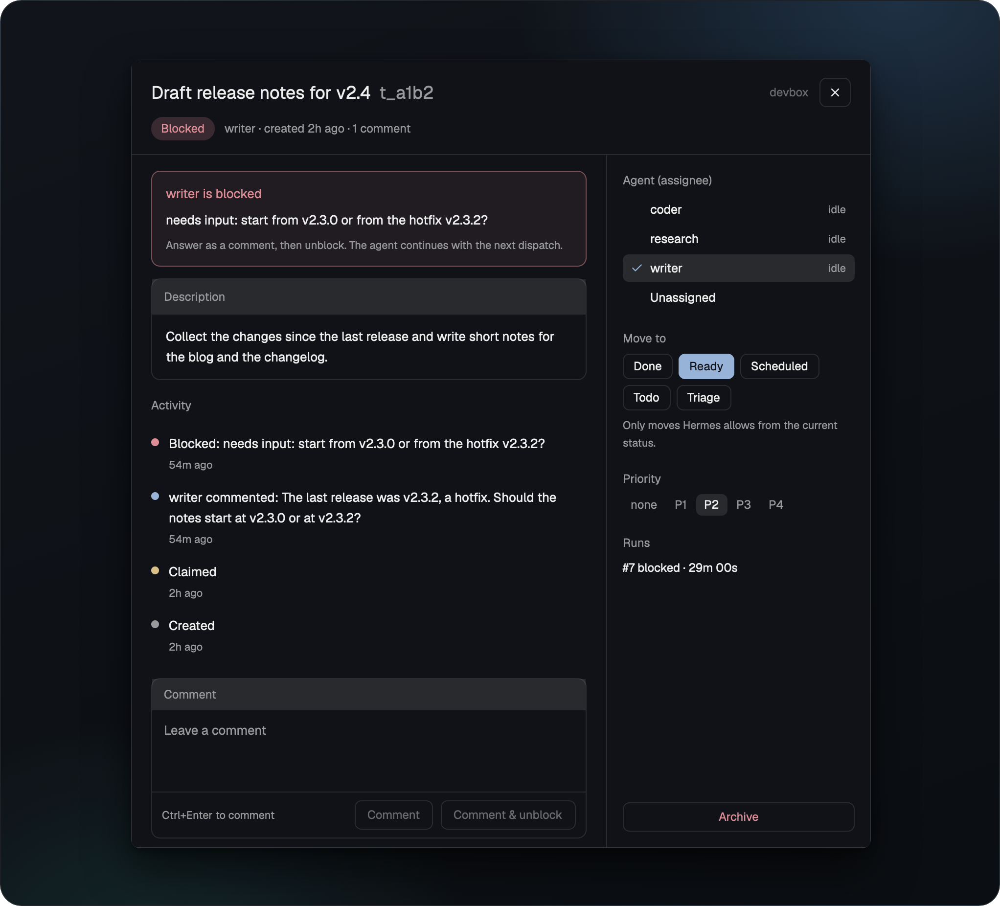

# Hermes Kanban


**A Kanban panel for the [Herdr app](https://herdr.dev): it follows the focused pane and shows the board of the Hermes agent running there.**

- **Follows your pane:** focus a pane that runs Hermes and the panel shows that instance's board at once, while it syncs in the background.
- **One board at a time:** every instance keeps its own board; tasks of two machines never mix, and an action goes only to the machine its task came from.
- **Steer tasks:** move a task, set its priority, assign it, comment, unblock or archive it, and create new ones, right from the panel.
- **Hears back:** a toast tells you when a task finishes, needs you or fails, and a click jumps to the pane; a dot on the tab bar button shows what you have not seen yet.
- **Stays on the machine:** the access key never leaves the Hermes machine, never shows up in a command line and never reaches your Mac.
- **Quiet:** a cheap check of the board's timestamp every 30 s, the board itself only when it changed, and a gateway restart never floods you with toasts.

<br>

<p align="center"><a href="https://www.buymeacoffee.com/michaelmayer"></a></p>

<br>

## Install

In Herdr, ask your agent:

```text
Read ~/.config/herdr-app/AGENTS.md, then add this mod: https://github.com/Srv-02/herdr-hermeskanban/tree/main
```

Then click `Hermes` in the tab bar.

- **Needs** Herdr on macOS, Hermes Agent 0.23.4 or newer on a Linux machine that Herdr reaches as one of its machines, and `curl` 7.55 or newer there.
- **Update:** the gear turns gold when a new release is out; ask your agent the same way.
- **By hand, removing, keys:** see the [guide](docs/GUIDE.md#install).

## Features

### Board

- **Grouped as in Hermes:** Triage, Todo, Scheduled, Ready, Running, Blocked, Review, Done, in Hermes' own order and colors; empty groups are left out. Or grouped by agent, or not at all.
- **Sorted as Hermes dispatches:** the highest priority first, the oldest first among equals.
- **Each row:** status, title, `t_a1b2 · writer · 14m`, and a hint: why a task is blocked, `starts with next dispatch`, or `no agent, will not start`; comments and priority on the right.
- **Filter:** `Open | Done | All`, one or more agents, and a search over ID, title and agent. The funnel adds priority (`All | P1 | P2 | P3+`) and grouping.
- **Status bar:** `3 running · 1 problem`, the gateway's dot and the Hermes version.



### Task overlay

- **The task:** its status, agent and age, the blocked reason in a red box, the description and the activity: events and comments, newest first.
- **Act on it:** comment, or **Comment & unblock** a blocked task; assign an agent; **Move to** only what Hermes allows from the current status; set the priority; archive with a second click to confirm.
- **Hermes has the last word:** the line at the bottom tells where the task really went (`Hermes moved it to Ready`), not where it was sent.
- **New task:** the `+` in the header asks for a title, a description, a priority and an agent, on the instance the panel shows.



### Notifications

- **Toasts** when a task needs you (blocked, waiting for review, cycling between blocked and unblocked), fails or finishes: `devbox: writer needs input`. A click jumps to that instance's Hermes pane.
- **The dot** on the `Hermes` button: red for something new that needs you, green for something newly done; opening the panel on that instance clears it. No dot for tasks that just stay blocked or agents that run.
- **Other instances:** a red strip `labbox needs you` with `Go to pane →` under the header when another visible instance has news for you.
- **Sounds** and a Dock badge, each with its own switch.


### Set up access

- **An instance that signs people in** needs a key of Hermes Kanban's own. **Set up access** lists every step, asks, writes a key and a systemd drop-in on that machine, and waits.
- **No restart without you:** the gateway restarts only when you click **Restart gateway**; then the panel checks the key and shows the board.
- **Remove access** in the settings undoes it in a safe order: the drop-in, then a restart on your click, then the key.
- **An instance without sign-in** needs nothing: the panel uses the web app's own token there.

### Settings

- **The gear** opens the settings: single agent mode for the shown instance (agent names, filter and picker disappear), status colors, toasts, sounds, the Dock badge and how often to check.
- **Updates:** once a day the panel asks GitHub for a new release. The gear turns gold when one is out, and the dialog tells you what to ask your agent.


### And

- **Follow me, strictly:** a pane without Hermes shows `No Hermes in this pane`, never the last board. Clicking into the panel keeps the board.
- **Only what you have open:** a machine counts while it has at least one open space; close its last space and its board, dot and toasts go.
- **Safe text:** titles, descriptions and comments from Hermes show as plain text; only `https` links open, and only on a click.
- **After a Hermes update** that changes the board's shape, the panel says `Hermes <version> not supported yet` instead of showing wrong data.

## Documentation

- **[Guide](docs/GUIDE.md):** every feature, setting and key in detail, and what it runs.
- **[RECIPE.md](RECIPE.md):** the mod as a brief to build it from scratch.
- **[Development](docs/GUIDE.md#development):** tests and lint.

## Credits

- The panel, its tab bar button, the settings and the tooling follow [GitHub Checker](https://github.com/Srv-02/herdr-ghchecker) (MIT).
- The segmented control and the empty states come from [herdr-github](https://github.com/alarboulletmarin/herdr-github) by alarboulletmarin (MIT), the tab bar button from [herdr-issues](https://github.com/jankeesvw/herdr-issues) by Jankees van Woezik (MIT), both through GitHub Checker.
- Icons from [Lucide](https://lucide.dev) (ISC).

Details in [THIRD_PARTY_NOTICES.md](THIRD_PARTY_NOTICES.md). Hermes Kanban is not affiliated with Nous Research.

## License

MIT, see [LICENSE](LICENSE). Third party parts keep their own licenses.
